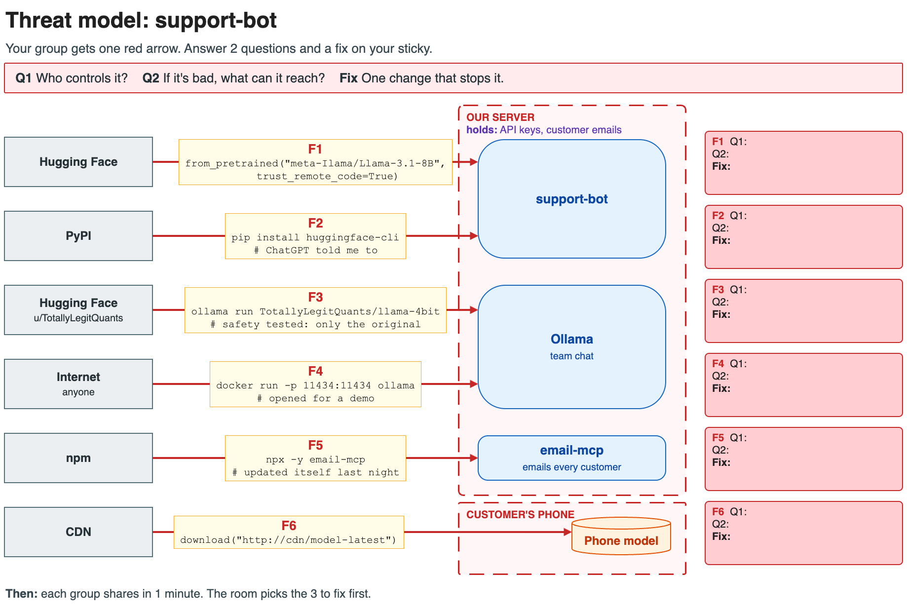

# Lab 07: threat model a support bot

To add stickies, open `support-bot-threat-model.drawio` in [app.diagrams.net](https://app.diagrams.net) (File → Open from → Device).

**For your red arrow, answer:**
1. Who controls it?
2. If it's bad, what can it reach?
3. Fix: one change that stops it.

| Step | Time | What |
|---|---|---|
| 1 | 2 min | Look at the diagram. Find the boxes that hold keys |
| 2 | 8 min | Your group gets one red arrow (F1 to F6). Fill in its sticky: Q1, Q2, Fix |
| 3 | 6 min | Each group shares in 1 minute |
| 4 | 2 min | The room picks the 3 to fix first |

Rule for picking: **anyone can reach it + it holds keys = fix first.**
